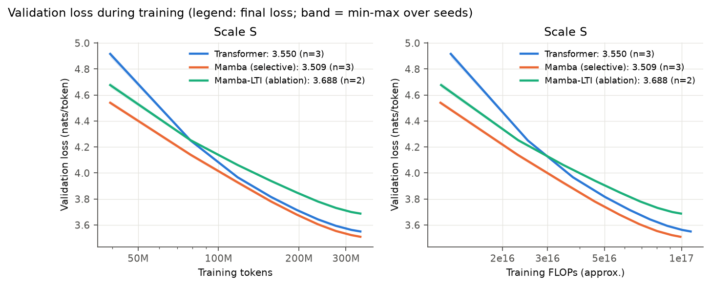

# Swapping Attention for Selective State Spaces

Training and evaluating a Mamba-style small language model against a Transformer of the same size.

AFML course project (UE24AM342AA1), PES University. **Team Abcd:**

| Name | SRN |
| --- | --- |
| Krishna G Pai | PES1UG24AM372 |
| Dikshith Varma M N | PES1UG24AM363 |
| Gagandeep N | PES1UG24AM367 |
| Mallikarjuna Rao R V | PES1UG24AM155 |

## Question

We give a Transformer and a Mamba-style selective state-space model the same parameter count (about 47M),
the same data and the same number of training tokens. How do they compare in language-modelling quality,
recall, long-context behaviour and inference cost? And what does Mamba's input-dependent (selective) state
update contribute? To answer the second part we also train Mamba-LTI, a copy of Mamba whose state update
does not depend on the input.

## Deliverables

| Item | Where | Status |
| --- | --- | --- |
| Code, configs, notebook, results | this repository | complete |
| Links to the datasets | [deliverables/datasets.md](deliverables/datasets.md) | complete |
| Paper (IEEE format, PDF) | [deliverables/paper/](deliverables/paper/) | full LaTeX draft (all sections); final edits, then PDF |
| Slide deck (PDF) | [deliverables/slides/](deliverables/slides/) | filled on the course template; final edits, then PDF |
| Presentation video (at most 7 minutes) | [deliverables/video/](deliverables/video/) | to be recorded |

## Results at a glance

Every number below is copied from a file in [results/](results/); [results/README.md](results/README.md)
says which file. All models have about 47M parameters and saw 340M training tokens. Each run used one free
Kaggle T4 GPU.

| | Transformer | Mamba | Mamba-LTI |
| --- | --- | --- | --- |
| Test loss, mean ± std over seeds (nats/token) | 3.531 ± 0.005 (3 seeds) | **3.484 ± 0.005** (3 seeds) | 3.661 ± 0.006 (2 seeds) |
| Test perplexity | 34.14 | **32.59** | 38.88 |
| Test loss on recall-hit tokens (16.8% of tokens) | **1.387** | 1.762 | 2.416 |
| Test loss on all other tokens | 3.964 | **3.832** | 3.912 |
| PG-19 loss at positions 8K–16K (trained on 1K; seed 0) | 5.619 | **3.879** | 4.102 |
| Memory while decoding, batch 8, 32K context | 6,260.5 MiB | **116.0 MiB** | not measured |
| Decode time per new token, batch 8, 32K context | 46.5 ms | **23.9 ms** | not measured |
| Training time per run | 4.0–4.4 h | 8.2–8.5 h | 7.4–8.1 h |

Mamba numbers for decoding and training use the official `mamba-ssm` kernel (the `cuda` scan backend).



### What we found

1. **Quality (E1).** Mamba's mean test loss is 0.046 lower than the Transformer's. The seed-to-seed
   standard deviation is at most 0.006 for every model, so the gap is not seed noise.
2. **Selectivity (E2).** Removing selectivity (Mamba-LTI) raises the test loss by 0.176 over Mamba. On
   selective copying (40,000 training steps), Mamba reached 99% accuracy at both lengths and both learning
   rates. Mamba-LTI reached 99% only at learning rate 3e-3, after 28,000–29,000 steps; at 1e-3 it stopped at
   54.2% (length 64) and 12.9% (length 256). The Transformer reached 99% at length 64 but only 91.9–93.3% at
   length 256.
3. **Recall (E3).** A recall-hit token is a position where the pair (current token, next token) already
   appeared earlier in the same 1,024-token window, so the answer can be copied from the context. The
   Transformer is best on these tokens (1.387 against Mamba's 1.762); Mamba is best on all other tokens
   (3.832 against 3.964). On MQAR (length 128, 16 key-value pairs, one seed, four learning rates), no model
   solved width 64 (best 19.6%). At widths 128 and 256 both the Transformer and Mamba reached at least 99.5%,
   but each only at one of the four learning rates. Mamba-LTI never went above 20.6%.
4. **Long context (E4).** On 50 PG-19 books, the Transformer's loss rises from 3.396 (positions 512–1,024)
   to 5.619 (positions 8K–16K), past its 1,024-token training length. Mamba's rises from 3.399 to 3.879.
5. **Inference (E5).** On one T4 in fp16, the Transformer's KV cache grows with the context. At batch 8 its
   decoding memory goes from 210.6 MiB (512 tokens) to 6,260.5 MiB (32K). Mamba's stays at 114.0–116.0 MiB,
   because its recurrent state has a fixed size (7.1 MiB at batch 8). Up to 8K tokens the Transformer decodes
   faster; at 32K Mamba is faster at both batch sizes. Our pure-PyTorch `chunked` scan computes the same
   result as the `cuda` kernel but is about 20 times slower at prefill (21.2 s against 1.04 s at 32K tokens,
   batch 1). That is an implementation effect, not an architecture effect.
6. **Mechanism (E6).** For the seed-0 Mamba, the median memory horizon 1/(Δ·|A|) of the state channels is
   3–31 tokens in 22 of the 24 layers. Layers 14 and 18 (counting from 0) keep information longer: 80 and 225
   tokens.
7. **Instruction fine-tuning (E7).** We fine-tuned both seed-0 models on Alpaca-cleaned (49,570 training
   examples, 2 epochs, learning rate 3e-4 chosen on validation). Test loss on the response tokens fell from
   2.993 to 2.201 (Transformer) and from 2.975 to 2.163 (Mamba). ROUGE-L on 100 test prompts rose from 0.027
   to 0.212 and from 0.000 to 0.222. After fine-tuning, 54–55% of answers end on their own with an
   end-of-text token; before, none did.
8. **Same training time instead of same tokens.** On a free T4, the Transformer runs finished their 340M
   tokens in 4.0–4.4 hours (mean 4.16 h), at a mean validation loss of 3.550. At 4.16 hours the Mamba runs
   had seen 157M tokens and were at 3.770–3.792; they needed 6.70–7.25 hours to reach 3.550. So per token
   Mamba is better, but per hour of free-GPU time the Transformer is ahead. Two caveats: Mamba's 4-hour value
   comes from the middle of a longer run, before its learning rate decayed, so a Mamba run planned for 4 hours
   would do somewhat better; and the result depends on this GPU and these kernels (fp16, `mamba-ssm` `cuda`
   scan). See [fig9](results/figures/fig9_time_budget.png) and
   [table_time_budget.md](results/figures/table_time_budget.md).

More figures: selective copying ([fig2](results/figures/fig2_selective_copy.png)), MQAR
([fig3](results/figures/fig3_mqar.png)), recall split ([fig4](results/figures/fig4_recall_split.png)),
PG-19 ([fig5](results/figures/fig5_long_context.png)), efficiency
([fig6](results/figures/fig6_efficiency.png)), memory horizon
([fig7](results/figures/fig7_memory_horizon.png)), fine-tuning ([fig8](results/figures/fig8_sft.png)).
Full tables: [main](results/figures/table_main.md), [synthetic tasks](results/figures/table_synthetic_long.md),
[fine-tuning](results/figures/table_sft.md).

### Limitations

- **Scale.** 47M parameters and 340M tokens (about 7 tokens per parameter, below the compute-optimal ~20).
  Published Mamba results start at 130M parameters, so these trends may change at larger scale.
- **Seeds.** Three seeds for the Transformer and Mamba and two for Mamba-LTI in E1. The synthetic tasks,
  PG-19, the Δ analysis and fine-tuning use one seed.
- **Tuning.** Learning rates were chosen with 30M-token runs on the validation split. Mamba-LTI reuses
  Mamba's learning rate.
- **Hardware.** Free T4 GPUs, fp16. Speed and memory numbers describe these implementations on this GPU.

## Repository layout

```text
afml/                     the code
  config.py               model settings
  models/                 transformer.py, mamba.py (scans: sequential, parallel, chunked, cuda), lm.py
  data/                   build.py (FineWeb-Edu + PG-19 -> 16K BPE token files), loader.py
  train.py                trainer: warmup + cosine, AdamW, fp16/bf16, grad accumulation, resume
  sft.py                  instruction fine-tuning on Alpaca-cleaned
  eval/                   perplexity, long_context, synthetic, bench, analysis
configs/                  data.json and the parameter-matched model configs
scripts/                  make_configs, sweep_lr, smoke_report, collect_results, make_figures
notebooks/run_study.ipynb runs every stage on a free Kaggle (or Colab) GPU
tests/                    correctness tests: every scan matches the step-by-step reference
results/                  every number in the paper; README.md maps files to experiments
  figures/                all figures and tables (made by scripts/make_figures.py)
deliverables/             paper, slides, video and dataset links for the submission
docs/REPRODUCE.md         how to rerun everything, and which team member ran which stage
```

## Models

Vocabulary 16,384, context 1,024. Mamba uses two layers for each Transformer layer, and
`scripts/make_configs.py` searches Mamba's inner width so the non-embedding parameter counts match.

| Model | Layers | Width | Inner width | Non-embedding params | Total params | Gap to Transformer |
| --- | --- | --- | --- | --- | --- | --- |
| Transformer | 12 | 512 | – | 38,547,968 | 46,936,576 | – |
| Mamba | 24 | 512 | 968 | 38,461,760 | 46,850,368 | 0.22% |
| Mamba-LTI | 24 | 512 | 1,032 | 38,626,880 | 47,015,488 | 0.20% |

A pair of about 98M parameters (`configs/M_*.json`) is configured but was not trained: the smoke test put it
at about 104–105 hours per run on a T4.

**Why 340M tokens and not 20 per parameter (940M).** The smoke test measured 10,370 (Transformer) and 10,815
(Mamba, `cuda` scan) training tokens per second on a T4, so 940M tokens would take about 25 hours per run.
340M tokens fits in one free 12-hour Kaggle session. Every run sees exactly 339,869,696 tokens (2,593 steps of
131,072 tokens), sampled at random positions from the same training split.

## Run it

On a laptop (CPU), check that everything works:

```bash
python -m pip install -r requirements.txt
python -m pytest -q
```

The experiments run on free Kaggle GPUs through `notebooks/run_study.ipynb`. Set `STAGES` in its first code
cell (`data`, `smoke`, `sweep`, `S`, `synthetic`, `synthetic_long`, `mqar_long`, `mqar_long_extra`, `eval`,
`sft`, `figures`) and run it. Step-by-step instructions, stage times and single commands are in
[docs/REPRODUCE.md](docs/REPRODUCE.md). To remake every figure and table from the files in `results/`:

```bash
python scripts/make_figures.py --results results --out results/figures
```

## Rules we followed

- The validation split chooses checkpoints and learning rates. The test split is scored once at the end.
- Perplexities compare only models that share this tokenizer and test set.
- Every speed or memory number names the Mamba scan backend.
- Results we did not expect (for example, the Transformer beating Mamba on recall-hit tokens) are reported
  as measured.

## References

- Gu & Dao (2023), [Mamba: Linear-Time Sequence Modeling with Selective State Spaces](https://arxiv.org/abs/2312.00752)
- Gu, Goel & Ré (2021), [Efficiently Modeling Long Sequences with Structured State Spaces (S4)](https://arxiv.org/abs/2111.00396)
- Dao & Gu (2024), [Transformers are SSMs (Mamba-2)](https://arxiv.org/abs/2405.21060)
- Arora et al. (2023), [Zoology: Measuring and Improving Recall in Efficient Language Models](https://arxiv.org/abs/2312.04927)
- Hoffmann et al. (2022), [Training Compute-Optimal Large Language Models (Chinchilla)](https://arxiv.org/abs/2203.15556)
- Datasets: see [deliverables/datasets.md](deliverables/datasets.md)
