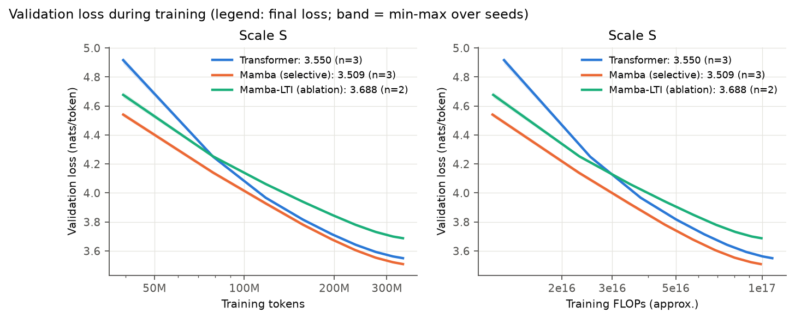
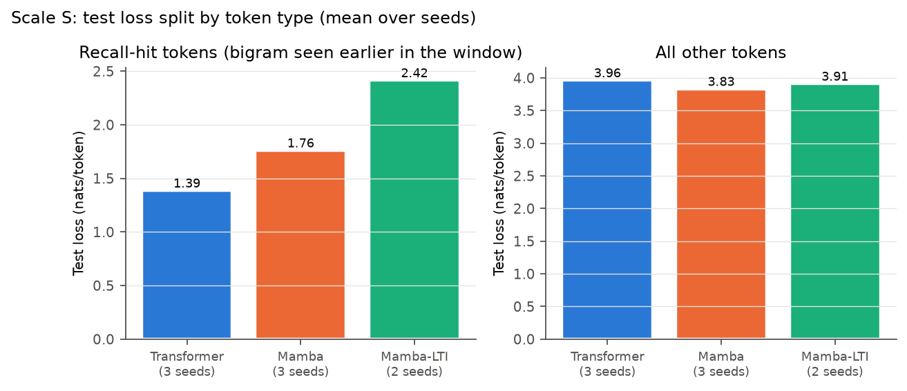
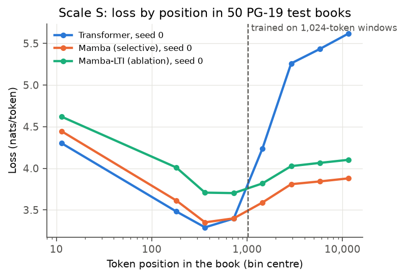
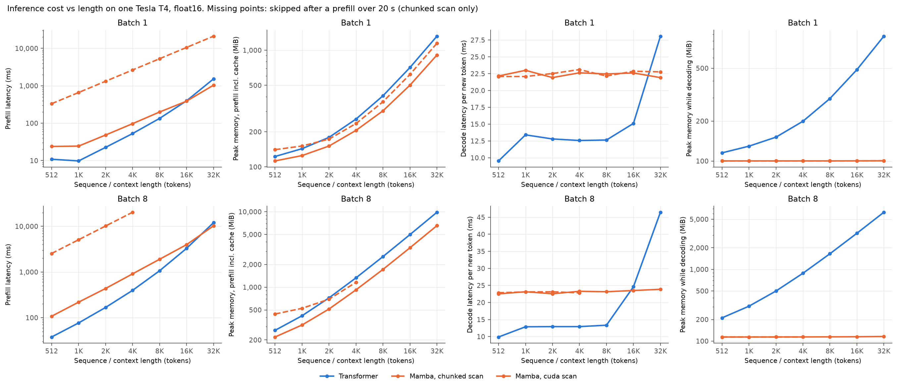
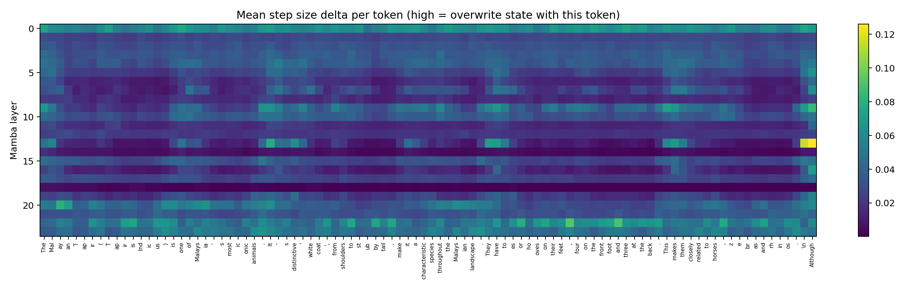
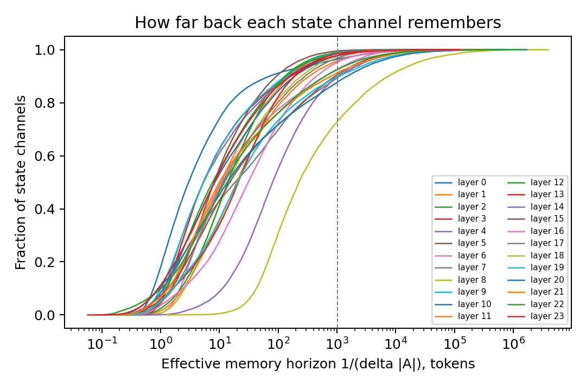
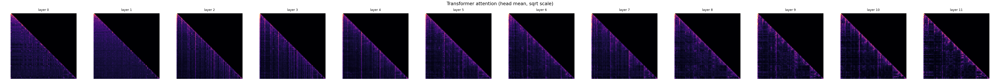

# Swapping Attention for Selective State Spaces: Training and Evaluating a Mamba-Style Small Language Model

**Team Abcd:** Krishna G Pai (PES1UG24AM372), Dikshith Varma M N (PES1UG24AM363),
Gagandeep N (PES1UG24AM367), Mallikarjuna Rao R V (PES1UG24AM155)

**Course:** UE24AM342AA1 Advanced Foundations of Machine Learning, PES University

> **Draft status.** The method, setup and limitations (sections 1 to 6, 9 to 11) are written. Every
> place that needs a measured number is marked **TODO(results)** and names the file in `results/`
> that supplies it. No result in this draft is estimated. Design values (model sizes, token budgets,
> step counts) come from `configs/` and `scripts/make_configs.py`; the trained runs record the same
> values in `results/<scale>/runs/*/summary.json`, which is the source to cite in the final version.

## Abstract

TODO(results): write last, in 5 sentences: the question; the setup (parameter-matched models at
~47M parameters, 340M training tokens each, FineWeb-Edu); the main quality result
(`results/figures/table_main.md`); the recall and long-context results (Figures 3 to 5); the
efficiency result with the Mamba scan backend named (Figure 6).

## 1. Introduction

A Transformer reads its context through attention. Every new token compares itself with every earlier
token, so prefill compute grows with the square of the context length, and the key-value (KV) cache
used for generation grows linearly with it. State-space models (SSMs) replace attention with a linear
recurrence whose state has a fixed size, so generation needs constant memory and constant time per
token.

Early SSMs such as S4 are *linear time-invariant* (LTI): every token is processed with the same
dynamics. That allows fast convolutional training but gives the model no way to decide, based on
content, what to store and what to ignore. Mamba makes the recurrence *selective*: the step size and
the input and output maps depend on the current token.

**Research question.** At the same parameter count, the same data and the same token budget, how
does a Mamba-style small language model (SLM) compare with a Transformer SLM in quality and in
inference efficiency, and what does selectivity contribute?

**What this study does.**

1. Trains parameter-matched Transformer and Mamba models (~47M parameters, 3 seeds each) on identical
   data with an identical budget of 340M training tokens.
2. Adds a selectivity ablation (Mamba-LTI) with the same size and training.
3. Tests associative recall two ways: the synthetic MQAR task, and a split of natural-text test loss
   into "recall-hit" tokens and all other tokens.
4. Measures loss beyond the training length (1,024 tokens) on PG-19 books up to 16,384 tokens.
5. Compares inference cost with cached decoding for both models: KV cache against recurrent state.
6. Inspects what the selective step size does on real text.

## 2. Background

### 2.1 Attention

Causal self-attention computes `softmax(QKᵀ / √d) V` with future positions masked. Prefill over L
tokens costs O(L²·d) per layer. Decoding one token with a KV cache costs O(L·d) per layer and keeps
2·L·d cached values per layer.

### 2.2 State-space layers

A diagonal SSM channel keeps a state `h` of size N (here N = 16) and updates it per token:

```text
h_t = exp(Δ·A) ⊙ h_{t-1} + Δ·B·u_t
y_t = C · h_t + D·u_t
```

`A` is diagonal and negative, so `exp(Δ·A)` lies between 0 and 1 and acts as a forget factor. In S4
(LTI), `Δ`, `B` and `C` are the same for every token.

### 2.3 Selectivity

Mamba computes `Δ_t = softplus(W_Δ x_t + b)`, `B_t = W_B x_t` and `C_t = W_C x_t` from the current
token. A large `Δ_t` makes `exp(Δ_t·A)` close to 0, so the state is overwritten with the current
token. A small `Δ_t` keeps the state and ignores the token. A channel's memory horizon is therefore
about `1 / (Δ_t·|A|)` tokens. Because the dynamics change per token, training cannot use a
convolution and needs a scan over the sequence.

### 2.4 Associative recall

Zoology (Arora et al., 2023) found that most of the quality gap between attention and
attention-free models comes from associative recall: retrieving a value seen earlier in the context
when its key reappears. Attention can look the key up directly. A recurrent model must already have
stored the pair in its fixed-size state.

## 3. Models

### 3.1 Transformer

Pre-norm decoder with RMSNorm, rotary position embeddings (RoPE, base 10,000), a SwiGLU MLP (hidden
size 8/3 of the width, rounded up to a multiple of 64), PyTorch scaled-dot-product attention, and
input and output embeddings tied. Generation uses a KV cache.

### 3.2 Mamba

Each layer is RMSNorm, a Mamba-1 block and a residual connection. The block has these parts:

1. An input projection to a signal `x` and a gate `z`, each of width `d_inner`.
2. A causal depthwise convolution of width 4 followed by SiLU.
3. The selective SSM with state size 16 and a Δ projection of rank ⌈width / 16⌉.
4. Gating by SiLU(`z`) and an output projection.

`A` starts from the S4D-real values −1 to −16, and the Δ bias starts so that `softplus(Δ)` lies
between 0.001 and 0.1. A Mamba layer has no MLP, so the Mamba models use two layers for each
Transformer layer, as in the Mamba paper. Generation uses the recurrent state (convolution state and
SSM state), whose size does not depend on the context length.

### 3.3 Mamba-LTI ablation

Δ, B and C are replaced by learned constants that do not depend on the input. Everything else is
identical, so the ablation removes selectivity and nothing more.

### 3.4 Parameter matching

All models share the width, vocabulary (16,384) and tied embedding. The Mamba `d_inner` is found by
binary search so that non-embedding parameters are within 0.5% of the Transformer's.

| Scale | Width | Model | Layers | d_inner | Non-embedding params | Total params | Gap |
| --- | --- | --- | --- | --- | --- | --- | --- |
| S | 512 | Transformer | 12 | - | 38,547,968 | 46,936,576 | - |
| S | 512 | Mamba | 24 | 968 | 38,461,760 | 46,850,368 | −0.22% |
| S | 512 | Mamba-LTI | 24 | 1,032 | 38,626,880 | 47,015,488 | +0.20% |

Source: `python scripts/make_configs.py`. TODO(results): confirm against
`results/S/runs/*/summary.json`.

### 3.5 Scan implementation

The selective scan has four interchangeable implementations. All of them return the same outputs and
the same training gradients, which `tests/test_scans.py` checks against the step-by-step reference and,
on the GPU, for whole Mamba blocks. (The fused kernel does not backpropagate through the final state it
returns; training never uses that state.)

| Backend | What it is | Used for |
| --- | --- | --- |
| sequential | one step at a time | reference in tests |
| parallel | Hillis-Steele scan over the whole sequence | tests only: keeps too many large tensors for backpropagation at length 1,024 |
| chunked | parallel scan inside chunks of 64 tokens with activation checkpointing; state carried between chunks | default training path, pure PyTorch |
| cuda | official fused kernel from `mamba-ssm` | used when it installs on the GPU |

The scan always runs in fp32. Every speed or memory number in this report names its backend, because
a slower pure-PyTorch scan is an implementation effect, not an architecture effect.

TODO(results): state which backend each run used, from the `scan_backend` field of
`results/<scale>/runs/*/summary.json`.

## 4. Data

**Training text.** FineWeb-Edu, subset `sample-10BT`, at the pinned revision
`87f09149ef4734204d70ed1d046ddc9ca3f2b8f9`. The pipeline:

1. Streams the subset, shuffled with seed 1234 and a 10,000-document buffer.
2. Drops exact duplicates by the SHA-256 hash of the stripped text.
3. Assigns each document to test (1%), validation (1%) or train from its hash, so the split does not
   depend on order.
4. Fits a byte-level BPE tokenizer with 16,384 tokens on 100,000 training documents only.
5. Separates documents with an end-of-document token.

The build targets 2B training tokens and 10M tokens each for validation and test.

TODO(results): actual token and document counts per split, duplicates dropped and the tokenizer hash,
from `results/data/meta.json`.

**Long-context text.** PG-19 test books from the Parquet copy `emozilla/pg19`, keeping the first 50
books that have at least 16,385 tokens under our tokenizer. TODO(results): book list from
`results/data/pg19_meta.json`.

## 5. Training

| Setting | Value |
| --- | --- |
| Optimizer | AdamW, β = (0.9, 0.95), weight decay 0.1 on weight matrices only |
| No weight decay on | norms, biases, embeddings, `A_log`, `D`, Δ bias |
| Schedule | linear warmup over 2% of steps (51 steps), cosine decay to 10% of the peak |
| Gradient clipping | 1.0 |
| Context length | 1,024 tokens |
| Tokens per optimizer step | 131,072 (micro-batch × gradient accumulation × 1,024) |
| Training tokens | 340M (2,593 steps), about 7 per parameter, identical for every model |
| Precision | fp16 with loss scaling on the T4 (no native bf16); the scan in fp32 |
| Validation | 2M validation tokens every 150 steps; the best validation checkpoint is kept |
| Seeds | Transformer and Mamba: 0, 1, 2. Mamba-LTI: 0, 1 |

If a micro-batch does not fit in GPU memory, the trainer halves it and doubles gradient
accumulation, so the tokens per step never change.

**Why 340M tokens.** The plan was about 20 tokens per parameter (940M tokens, following Chinchilla).
A GPU smoke test measured the training speed of both models on the free Kaggle T4, which made a full
run about 25 hours. The budget was therefore set so the slower model finishes within one 11-hour free
session, and the step size was reduced so the shorter runs still get about 2,600 optimizer updates.
TODO(results): cite the measured tokens per second from `results/smoke/smoke_report.md`.

**Learning rate.** The Transformer and Mamba are each trained for 30M tokens (228 steps), with the same
step size and the same 51 warmup steps as the main runs, at learning rates 3e-4, 6e-4, 1.2e-3 and 2.4e-3,
plus 1.5e-4 for the Transformer. The rate with the lowest validation loss is used for the full runs.
A rate whose training loss becomes NaN or infinite is recorded as diverged and not chosen. Mamba-LTI
uses the Mamba rate.

A first sweep set warmup to 2% of each sweep run's own length, which is only 4 steps. In that sweep
the two highest Mamba rates diverged and the Transformer's best rate was the lowest one tried, so the
grid edge was reached. Because the main runs warm up for 51 steps, that sweep was biased against high
rates; it was discarded and rerun with the main-run warmup. Its log is kept in
`results/S/sweep_v1_failed_log.txt`.

TODO(results): the sweep table and chosen rates from `results/S/lr_sweep.csv` and
`results/S/best_lr.json`. Note whether a best rate sits at the edge of the grid.

**Hardware.** Free Kaggle notebooks with two NVIDIA T4 GPUs (16 GB each), running two independent
runs at a time. Sessions end after 12 hours, so training saves a full checkpoint (model, optimizer,
loss scaler, random states) before the limit and resumes in the next session.

## 6. Evaluation protocol

The test split is scored once, with the checkpoint chosen on validation. Nothing is selected on the
test split.

| ID | Question | Protocol |
| --- | --- | --- |
| E1 | Quality | Test loss and perplexity on 5M test tokens in 1,024-token windows. Mean ± standard deviation over seeds |
| E2 | Does selectivity matter? | Mamba vs Mamba-LTI on E1, and on selective copying (16 tokens among noise, width 64, lengths 64 to 512) |
| E3 | Associative recall | MQAR: widths 64, 128, 256; lengths 64 to 512; key-value pairs = 0.25·L/2; 2 Transformer layers vs 4 Mamba layers; 4,000 steps, batch 64; best of learning rates 1e-3 and 3e-3; accuracy on 1,000 held-out sequences. Natural text: a test token is a *recall hit* if the pair (previous token, token) already appeared earlier in the same window |
| E4 | Length extrapolation | First 16,384 tokens of each PG-19 book in one forward pass; loss averaged in position bins that double in size from 128 tokens; seed-0 models. RoPE is used past 1,024 without scaling |
| E5 | Inference efficiency | Randomly initialised ~98M-parameter models (speed does not depend on the weights); prefill latency, peak memory, throughput and per-token decode latency for 512 to 32,768 tokens at batch 1 and 8; CUDA-event timing after warm-up, median of repeats; out-of-memory recorded as missing points; one row per Mamba backend |
| E6 | Mechanism | Δ per token on validation text, memory horizon 1/(Δ·\|A\|), and Transformer attention maps, for the seed-0 pair |
| E7 | Hybrid (optional) | Not run in this version |

## 7. Results

### 7.1 Language-modelling quality (E1)

TODO(results): paste `results/figures/table_main.md` here as Table 1.



*Figure 1. Validation loss against training tokens and training FLOPs. The band is the min-max over
seeds.*

TODO(results): one paragraph. Which model has the lower test loss? Is the gap larger than the seed
spread? Does Mamba-LTI fall behind Mamba?

### 7.2 Selectivity ablation (E2)

TODO(results): Mamba vs Mamba-LTI test loss from Table 1, and selective-copy accuracy from
`results/synthetic/selective_copy.csv` (Figure 3, right panel).

### 7.3 Associative recall (E3)


*Figure 3. Accuracy against sequence length on MQAR (left) and selective copying (right), at the
largest width tried, best learning rate.*


*Figure 3b. MQAR accuracy against model width, one panel per sequence length.*



*Figure 4. Test loss on recall-hit tokens and on all other tokens.*

TODO(results): from `results/synthetic/mqar.csv` and `results/<scale>/perplexity.csv`. Where does
Mamba's MQAR accuracy fall as length grows? Is Mamba's gap to the Transformer larger on recall-hit
tokens than on other tokens?

### 7.4 Length extrapolation (E4)



*Figure 5. Loss by token position on PG-19. The dashed line marks the training length.*

TODO(results): from `results/<scale>/long_context.csv`. What happens to each model's loss past 1,024
tokens?

### 7.5 Inference efficiency (E5)



*Figure 6. Prefill latency, peak prefill memory and per-token decode latency against length. Line
style shows the Mamba scan backend.*

TODO(results): from `results/bench/bench.csv`. Name the backend in every sentence. Where does the
Transformer run out of memory? How does decode latency scale for each model?

### 7.6 What selectivity does (E6)







TODO(results): from `results/analysis/S/delta_stats.json`. Which tokens get large Δ? How does the spread of memory horizons compare with the
training length?

## 8. Discussion

TODO(results). Answer the research question in one paragraph, then cover:

- whether the recall results (Figures 3 and 4) explain the quality gap in Table 1;
- what the LTI ablation shows about selectivity;
- the efficiency trade-off, separating architecture from implementation (scan backend).

## 9. Limitations

- **Scale and budget.** The models have 47M parameters and see 340M tokens, about 7 per parameter,
  below the compute-optimal ~20. Published Mamba results start at 130M parameters and much larger
  token budgets, so our trends may not hold at larger scale or with longer training. A ~98M-parameter
  pair was configured but not trained: on a free T4 each run would take several days.
  TODO(results): cite the estimate from `results/smoke/smoke_report.md`.
- **Seeds.** The Transformer and Mamba have 3 seeds each and Mamba-LTI has 2. Differences smaller than
  the seed spread should not be called significant.
- **Learning rate.** The rate is tuned with 30M-token runs, shorter than the 340M-token main runs.
- **One corpus and one tokenizer.** Perplexities compare only models that share this tokenizer and
  test set.
- **Free hardware.** The T4 has no native bf16, so training uses fp16. If `mamba-ssm` does not
  install, Mamba trains with our pure-PyTorch chunked scan: the recurrence is the same, but its speed
  reflects our implementation. The Transformer uses the attention kernels PyTorch provides on a T4.
  Efficiency results describe these implementations on this GPU.
- **Proxies.** The recall-hit split counts repeated token pairs, which is only one form of recall.
  PG-19 books differ from the web training text, which affects both models.
- **Ablation scope.** Mamba-LTI is trained only at scale S. The synthetic tasks use small models
  trained from scratch, separate from the language models.

## 10. Changes since Review 1

The Review 1 pilot (`results/pilot/README.md`) trained one 557,696-parameter Transformer on 307,200
tokens, reached a best validation perplexity of 114.60 and trained no Mamba model. The feedback was
that the model was far too small and that the comparison was never made. This version changes:

1. **Size and budget.** Models are about 84 times larger and train on about 1,100 times more tokens.
2. **Both architectures.** Both are trained and compared under identical conditions.
3. **A Mamba scan that trains at real size.** The chunked scan replaces the parallel scan, which ran
   out of memory.
4. **Training setup.** Added: a learning-rate schedule, mixed precision, resumable checkpoints and
   logging. Weight decay no longer applies to `A_log` and `D`.
5. **Fair evaluation.** Added: a held-out test split, multiple seeds, and cached decoding for both
   models.

## 11. Reproducibility

- **Code:** branch `upgrade/full-study` of
  <https://github.com/Gagan-1718/afml-transformer-vs-state-space-models>. TODO(results): final
  commit hash.
- **Runner:** `notebooks/run_study.ipynb` runs every stage on a free Kaggle or Colab GPU.
- **Data:** pinned FineWeb-Edu revision; tokenizer hash and split sizes in `results/data/meta.json`.
- **Tests:** `python -m pytest -q`.

## References

1. Gu, A., & Dao, T. (2023). Mamba: Linear-Time Sequence Modeling with Selective State Spaces. arXiv:2312.00752.
2. Gu, A., Goel, K., & Ré, C. (2021). Efficiently Modeling Long Sequences with Structured State Spaces (S4). arXiv:2111.00396.
3. Dao, T., & Gu, A. (2024). Transformers are SSMs: Generalized Models and Efficient Algorithms Through Structured State Space Duality (Mamba-2). arXiv:2405.21060.
4. Arora, S., et al. (2023). Zoology: Measuring and Improving Recall in Efficient Language Models. arXiv:2312.04927.
5. Hoffmann, J., et al. (2022). Training Compute-Optimal Large Language Models (Chinchilla). arXiv:2203.15556.
6. Penedo, G., et al. (2024). The FineWeb Datasets: Decanting the Web for the Finest Text Data at Scale. arXiv:2406.17557.
7. Rae, J. W., et al. (2020). Compressive Transformers for Long-Range Sequence Modelling (PG-19). arXiv:1911.05507.
8. Su, J., et al. (2021). RoFormer: Enhanced Transformer with Rotary Position Embedding. arXiv:2104.09864.
9. Shazeer, N. (2020). GLU Variants Improve Transformer. arXiv:2002.05202.
10. Zhang, B., & Sennrich, R. (2019). Root Mean Square Layer Normalization. arXiv:1910.07467.
