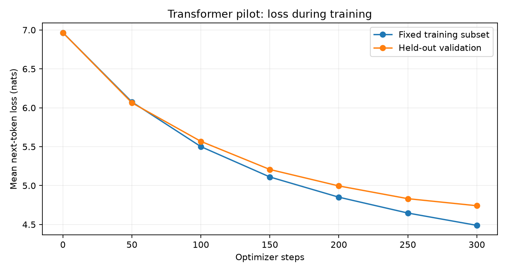

# Recorded Review 1 pilot

Measured on 30 October 2026. This is an initial Transformer experiment, not a comparison with Mamba.

| Item | Recorded value |
| --- | --- |
| Model parameters | 557,696 |
| Architecture | 2 Transformer layers, width 128, 4 heads |
| Vocabulary / context | 1,024 tokens / 128 tokens |
| Documents | 170 training, 30 validation |
| Prepared windows | 1,812 training, 494 validation |
| Updates / batch size | 300 / 8 |
| Training target-token exposures | 307,200 |
| Initial / final training-subset loss | 6.9659 / 4.4891 |
| Initial / final validation loss | 6.9662 / 4.7414 |
| Best validation perplexity | 114.60 |
| Best checkpoint step | 300 |
| Device / precision | CPU / float32 |
| Training plus evaluation and checkpointing | 54.00 seconds |
| Automated checks | 14 passed |

The training curve uses a fixed 32-window training subset. The validation curve scores all 494 validation windows. Validation selects the checkpoint, so it is not an untouched final test score.

Generation is operational but the sample text is often incoherent. See `samples.txt` for the unedited outputs. No Mamba quality, latency or memory result is claimed.

## Evidence

- `metrics.csv`: measured loss and perplexity at each evaluation step.
- `summary.json`: model settings, training settings, environment, results and samples.
- `data_manifest.json`: dataset revision, exact document IDs/hashes and tokenizer hash.
- `environment.txt`: the installed package versions for this CPU run, recorded for reference rather than as a portable Colab lockfile.
- `tests.txt`: test-suite output.
- `training_log.txt`: console log from the training run.

Raw documents and model weights are not in Git. The separately delivered demo bundle includes the trained checkpoint and tokenizer. The notebook can reproduce the pipeline with the pinned data revision.
